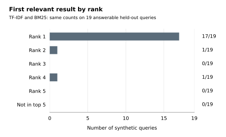
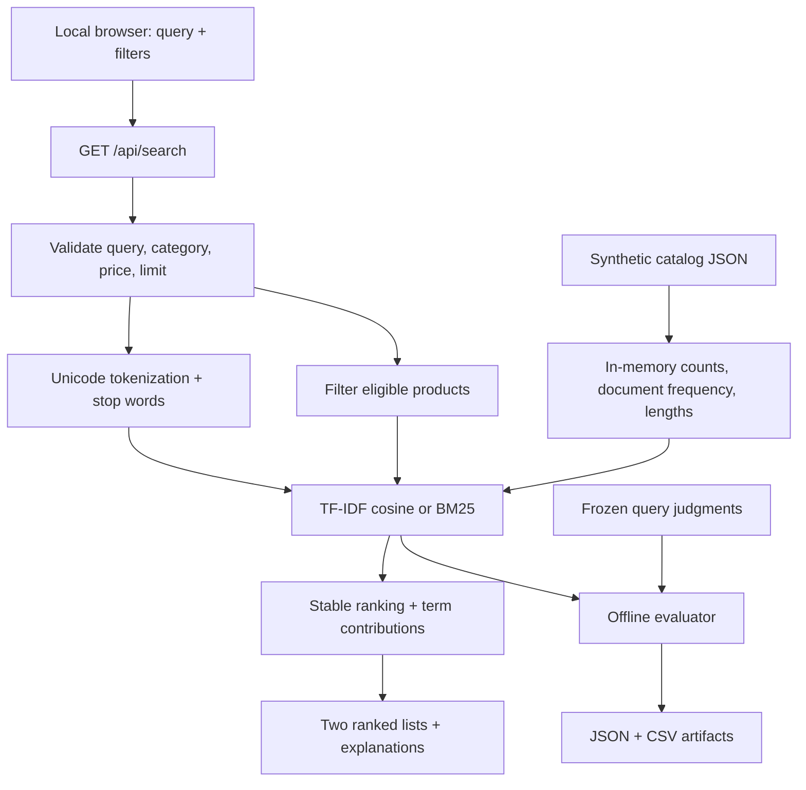

# Product Catalog Search

A runnable search laboratory for **54 clearly synthetic products**. Compare a TF-IDF cosine baseline with BM25, apply category and inclusive USD price filters, and inspect which query terms contributed to each score. Both methods are lexical. Dense semantic retrieval is **unimplemented**.

This is a new portfolio demo built with Codex assistance in October 2026. The catalog and query labels were authored for the demo; there is no retail/customer data, historical project claim, or production performance claim. See [data provenance](data/README.md) and [design decisions](docs/design.md).


## Evaluation at a glance



A diagnostic view of the checked-in **synthetic, author-labelled** evaluation—not a screenshot, independent benchmark, or claim that one method is better. Lower-order rankings can differ even when these metrics tie. [Figure source, data and reproduction](docs/VISUALS.md).

## Run locally

Python 3.11 or newer is required. There are **no third-party dependencies**, build step, API keys, network calls, or model downloads. Run commands from the repository root:

```sh
python -m catalog_search.server
```

Open <http://127.0.0.1:8000>. Use `--port 8011` if needed. The server binds to loopback by default. Stop it with Ctrl+C.

Try `charge laptop away from wall outlet`, `quiet keyboard`, or `wireless mouse`. Compare both ranked lists, then try the electronics category with a maximum price of `30`. Expand a product's score explanation. `garden hose` demonstrates an empty result; clearing the query browses the catalog in stable ID order without a relevance score.

## Verify and evaluate

```sh
python -m unittest discover -s tests -v
python -m compileall -q catalog_search tests
python -m catalog_search.evaluate --check
```

To regenerate the actual evaluation artifacts after an intentional data/code change:

```sh
python -m catalog_search.evaluate
```

The reproducible [JSON report](results/evaluation.json) includes catalog/query SHA-256 hashes and all rankings. The [per-query CSV](results/per-query.csv) supports manual error inspection. CI runs unit tests, live HTTP integration tests, compilation, and artifact recomputation on Python 3.11 and 3.14. A workflow file is provided; that alone does not establish a successful GitHub Actions run.

### Recorded evaluation

The 30 queries were fixed before evaluation: 10 development and 20 held-out, including one no-answer query in each split. No parameters were tuned after seeing held-out results. These are approximate author-created labels from a tiny, familiar synthetic catalog, **not an independent benchmark**.

| Split | Answerable / no-answer | Method | MRR@5 | Recall@5 |
| --- | --- | --- | --- | --- |
| Development | 9 / 1 | TF-IDF | 1.0000 | 1.0000 |
| Development | 9 / 1 | BM25 | 1.0000 | 1.0000 |
| Held-out | 19 / 1 | TF-IDF | 0.9342 | 1.0000 |
| Held-out | 19 / 1 | BM25 | 0.9342 | 1.0000 |

MRR@5 averages the reciprocal rank of the first relevant result within five results (zero if absent). Recall@5 averages the fraction of labeled relevant products retrieved in five results. Both average **only answerable queries**, with equal weight per query. No-answer false-positive rate is reported separately: both methods returned zero results for the single no-answer query in each split (0/1). This sample is too small to establish reliable rejection behavior or superiority of either method. Related but irrelevant lexical matches can still appear for other unsupported needs.

## Architecture



The standard-library HTTP server serves three explicit static files and two GET APIs. It never executes the query as code or opens user-selected files. Index statistics are built once across the full catalog; filters restrict eligible products before ranking. See [API details and scoring formulas](docs/design.md).

## Scope and limitations

- TF-IDF and BM25 rely on word overlap. No stemming, spell correction, synonyms, phrase parsing, negation understanding, or embeddings are implemented. The typo examples work only when other query words overlap.
- All non-stop query terms have OR semantics. A partial match can violate intent, budget language typed into the query, or a negated requirement. Use the explicit filter controls for price/category restrictions.
- Scores are comparable only within a method for the same query, not across methods or queries. They are ranking weights, not relevance probabilities.
- The catalog is small; exhaustive scanning is deliberate. There is no database, persistent user input, analytics, checkout, image asset dependency, or scalability claim.
- The cached dense model on the development machine lacked an installed inference stack. The project deliberately neither installs one nor downloads models. A future semantic implementation needs separate dependency, licensing, offline-model, evaluation, and privacy decisions.
- This local demo server is not hardened for Internet traffic. There is no hosted service, live deployment URL, authentication, or production deployment in this deliverable.

## Deployment instructions versus hosting status

**Hosting status: local demo only.** To demonstrate it on another computer, copy/clone the repository, install Python 3.11+, run the command above, and open the loopback URL there. A public service would require a production server, operational controls, and a separate deployment decision. No hosting resources have been provisioned.

## Repository contents

```text
catalog_search/       ranking, local HTTP API, offline evaluation
data/                 synthetic products, frozen judgments, provenance
static/               accessible vanilla HTML/CSS/JS comparison UI
tests/                scoring, malformed inputs, filters, metrics, HTTP
results/              reproducible evaluation JSON and per-query CSV
docs/                 design decisions and local verification evidence
.github/workflows/    CI definition
```

Code and synthetic data are available under the [MIT license](LICENSE).
